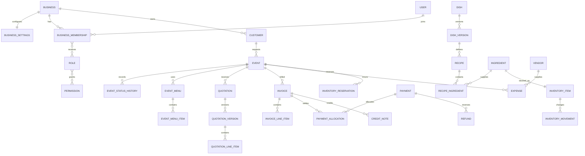

# SSC Synapse Database Design

The PostgreSQL model is normalized around business ownership, immutable commercial documents, append-only financial activity, and versioned menu data. UUID primary keys, UTC timestamps, explicit currency, and tenant-scoped uniqueness are used consistently. Prisma is the data-access layer, while database constraints remain the final defense for invariants that must survive application bugs or concurrency.

## Data conventions

| Convention         | Standard                                                                                                            |
| ------------------ | ------------------------------------------------------------------------------------------------------------------- |
| Primary keys       | UUID generated with PostgreSQL `gen_random_uuid()`                                                                  |
| Tenant key         | Required `businessId` on every tenant-owned aggregate and most child rows                                           |
| Timestamps         | `createdAt`, `updatedAt` as `timestamptz`; optional `archivedAt`, `deletedAt` only where policy permits             |
| Optimistic locking | Integer `version` on concurrently editable aggregates                                                               |
| Money              | `Decimal(19,4)` plus three-letter `currency`; issued totals rounded by currency policy                              |
| Quantities         | `Decimal(18,6)` plus unit identifier; never binary float                                                            |
| Local event time   | UTC instant plus the IANA timezone used to interpret it                                                             |
| Human numbers      | Tenant-scoped sequences, separate from UUID identity                                                                |
| Flexible data      | JSON only for provider payloads, immutable snapshots, or low-query metadata; not as a substitute for core relations |
| Archival           | Master data is archived; financial and audit records are retained and reversed rather than deleted                  |

Every foreign key includes an explicit deletion policy. `Restrict` is the default for referenced business records. Cascades are limited to private dependent rows that cannot exist independently, such as draft menu items deleted with an unissued draft.

## Relationship overview

The diagram shows primary relationships; supporting security, document, notification, AI, resource, and job tables are described below.

## Identity, tenancy, and authorization

| Model                | Important fields                                                                                                | Constraints and indexes                                                                                      |
| -------------------- | --------------------------------------------------------------------------------------------------------------- | ------------------------------------------------------------------------------------------------------------ |
| `Business`           | `id`, `slug`, `legalName`, `displayName`, `status`, `defaultCurrency`, `timezone`                               | Unique normalized `slug`; status index                                                                       |
| `BusinessSettings`   | `businessId`, document prefixes, locale, contact details, branding, default validity, feature flags, AI budgets | One-to-one with business; settings changes audited                                                           |
| `User`               | `id`, normalized `email`, `passwordHash`, `name`, `phone`, `status`, `lastLoginAt`                              | Globally unique normalized email; no `businessId` because a user may later join multiple businesses          |
| `BusinessMembership` | `businessId`, `userId`, `status`, `title`, `financialVisibility`, `joinedAt`                                    | Unique `(businessId,userId)`; indexes by user and active business memberships                                |
| `Role`               | `businessId?`, `key`, `name`, `isSystem`, `description`                                                         | System roles have null business; custom role key unique within business                                      |
| `Permission`         | `key`, `description`, `module`, `riskLevel`                                                                     | Globally unique permission key                                                                               |
| `MembershipRole`     | `membershipId`, `roleId`                                                                                        | Composite primary key; role scope validated by service and database trigger or migration constraint strategy |
| `RolePermission`     | `roleId`, `permissionId`                                                                                        | Composite primary key                                                                                        |
| `AuthSession`        | `userId`, `businessId?`, `refreshTokenHash`, `familyId`, `expiresAt`, `revokedAt`, device and IP metadata       | Index active sessions by user and family; token value is never stored                                        |
| `LoginAttempt`       | normalized identifier, outcome, IP hash, user agent, `createdAt`                                                | Time and identifier indexes for rate-limit analysis                                                          |
| `PasswordResetToken` | `userId`, token hash, `expiresAt`, `usedAt`                                                                     | Unique token hash; short retention                                                                           |
| `UserInvitation`     | `businessId`, normalized email, role selections, token hash, inviter, expiry, acceptedAt                        | Unique active invitation per business and email                                                              |

System roles are Owner, Manager, Accountant, Event Coordinator, Kitchen Manager, and Staff. Role names are presentation; permission keys such as `invoice.issue`, `payment.record`, and `settings.manage_ai` are the enforcement contract.

## Customer and communication models

| Model             | Important fields                                                                                                                                   | Rules                                                                                                         |
| ----------------- | -------------------------------------------------------------------------------------------------------------------------------------------------- | ------------------------------------------------------------------------------------------------------------- |
| `Customer`        | `businessId`, customer number, type, full name, company name, tax ID, billing address, preferred contact, dietary notes, general notes, archivedAt | Customer number unique per business; search indexes on normalized name and company                            |
| `CustomerContact` | `businessId`, `customerId`, type, label, raw value, normalized value, isPrimary, verifiedAt                                                        | Partial unique primary contact per type and customer; tenant index on normalized value for duplicate warnings |
| `CustomerNote`    | `businessId`, `customerId`, author, body, contact method, occurredAt                                                                               | Immutable author and creation data; edited body retains revision or audit entry                               |
| `CustomerMerge`   | `businessId`, source customer, target customer, actor, mergedAt, reason                                                                            | Prevents loss of duplicate-resolution history                                                                 |

Lifetime value and outstanding balance are derived from invoices and payments. They may later be materialized, but are not independently editable customer fields.

## Event and operational models

| Model                 | Important fields                                                                                                                                                                                                      | Rules and indexes                                                                                                        |
| --------------------- | --------------------------------------------------------------------------------------------------------------------------------------------------------------------------------------------------------------------- | ------------------------------------------------------------------------------------------------------------------------ |
| `Event`               | `businessId`, event number, customer, title, type, start/end instants, timezone, expected and confirmed guest counts, adult/child counts, service style, budget, currency, coordinator, status, instructions, version | Unique event number per business; date/status/customer/coordinator indexes; check end after start and nonnegative counts |
| `EventVenue`          | `businessId`, `eventId`, optional reusable venue, name, address, indoor/outdoor, access notes, start/end occupancy                                                                                                    | Index occupancy window; snapshot preserves the event's presented venue details                                           |
| `Venue`               | `businessId`, name, address, capacity, active, conflict policy                                                                                                                                                        | Search and active indexes; reusable master data                                                                          |
| `EventStatusHistory`  | event, from status, to status, reason, actor, timestamp                                                                                                                                                               | Append-only; transition service validates allowed graph                                                                  |
| `EventNote`           | event, author, body, visibility, createdAt                                                                                                                                                                            | Supports internal and customer-shareable notes                                                                           |
| `EventAssignment`     | event, membership, operational role, start/end, status                                                                                                                                                                | Unique relevant assignment; time indexes for conflict queries                                                            |
| `EventTask`           | event, parent task, title, category, assignee, dueAt, status, priority, completion metadata                                                                                                                           | Event/status/due-date and assignee indexes                                                                               |
| `Resource`            | business, type, name, quantity or capacity, active                                                                                                                                                                    | Represents equipment groups, vehicles, rooms, and other constrained assets                                               |
| `ResourceReservation` | event, resource, quantity, start/end, status                                                                                                                                                                          | Exclusion or transaction-safe conflict check; index by resource and time range                                           |

The status graph begins with Inquiry, Quotation Draft, Quotation Sent, Negotiation, Confirmed, In Preparation, In Progress, Completed, and Closed, with guarded transitions to Cancelled or Postponed. Resuming a postponed event records another history entry rather than erasing the prior state.

## Menu, recipe, and pricing models

| Model                | Important fields                                                                                                                                                                    | Rules                                                                           |
| -------------------- | ----------------------------------------------------------------------------------------------------------------------------------------------------------------------------------- | ------------------------------------------------------------------------------- |
| `DishCategory`       | business, name, slug, sort order, active                                                                                                                                            | Unique slug per business                                                        |
| `Dish`               | business, category, stable name, description, image document, active, proposedByAI                                                                                                  | Stable identity; mutable commercial and recipe details live in versions         |
| `DishVersion`        | dish, version number, effective range, serving unit, standard serving size, preparation minutes, cost per serving, selling price, currency, target margin, completeness, approvedBy | Unique `(dishId,versionNumber)`; effective date index; immutable after approval |
| `DietaryLabel`       | business, key, name, type                                                                                                                                                           | Unique business key; covers dietary and allergen labels                         |
| `DishDietaryLabel`   | dish version, label, classification, notes                                                                                                                                          | Composite uniqueness                                                            |
| `IngredientCategory` | business, name, unit family                                                                                                                                                         | Unique per business                                                             |
| `Ingredient`         | business, category, name, base unit, active, allergen metadata                                                                                                                      | Unique normalized name per business                                             |
| `Recipe`             | business, dish version, version number, yield quantity/unit, instructions, status, effective range, approvedBy                                                                      | Approved recipe is immutable; one active approved recipe per dish version       |
| `RecipeIngredient`   | recipe, ingredient, quantity, unit, wastage factor, optional                                                                                                                        | Unique ingredient occurrence or explicit sequence; unit conversion validation   |
| `PriceBook`          | business, name, currency, active, effective range                                                                                                                                   | Supports seasonal or customer-specific pricing later                            |
| `DishPrice`          | price book, dish version, unit price, effective range                                                                                                                               | No overlapping active range for same price book and dish version                |
| `MenuPackage`        | business, name, description, service style, active                                                                                                                                  | Stable package identity                                                         |
| `MenuPackageVersion` | package, version number, effective range, pricing mode, per-person price, currency, minimum guests, status                                                                          | Immutable after approval                                                        |
| `MenuPackageItem`    | package version, dish version, category role, quantity rule, optional surcharge                                                                                                     | Ordered items; version references prevent historical drift                      |
| `EventMenu`          | business, event, name, source, status, guest snapshot, currency, completeness, approvedBy, approvedAt, version                                                                      | Draft, AI Generated, Approved, Superseded statuses                              |
| `EventMenuItem`      | event menu, dish version, servings, price source, unit price snapshot, cost snapshot, notes                                                                                         | Snapshots become immutable when menu is approved or quoted                      |

Recipe costing resolves every ingredient quantity into its base unit, applies the selected ingredient cost version and wastage factor, then produces a completeness report. Missing conversions or prices block a claim of complete cost but do not fabricate a zero cost.

## AI governance models

| Model              | Important fields                                                                                                                                         | Rules                                                                                    |
| ------------------ | -------------------------------------------------------------------------------------------------------------------------------------------------------- | ---------------------------------------------------------------------------------------- |
| `PromptTemplate`   | business nullable, key, version, purpose, system text, schema version, status                                                                            | Unique key and version; published versions immutable                                     |
| `AIRecommendation` | business, event, requestedBy, type, status, input snapshot, output snapshot, model, prompt version, catalog version references, completeness, approvedAt | Retains provenance; sensitive input minimized                                            |
| `AIGenerationLog`  | business, user, recommendation, provider request ID, model, input/output tokens, estimated cost, latency, outcome, error code, createdAt                 | Usage indexes by business, user, model, and month; no secret or excessive prompt logging |
| `AIToolCall`       | generation, tool key, validated arguments, result summary, mutation flag, confirmation ID, outcome                                                       | Append-only                                                                              |
| `AIConfirmation`   | business, user, action hash, expiresAt, confirmedAt, consumedAt                                                                                          | One-time confirmation bound to exact arguments                                           |
| `AIBudget`         | business, optional user, period, request limit, token limit, cost limit, current usage                                                                   | Unique scope and period; usage updated transactionally                                   |

## Commercial document models

| Model                | Important fields                                                                                                                                                                         | Rules                                                                                        |
| -------------------- | ---------------------------------------------------------------------------------------------------------------------------------------------------------------------------------------- | -------------------------------------------------------------------------------------------- |
| `Quotation`          | business, quotation number, customer, event, current version, status, accepted version, createdBy                                                                                        | Number unique per business; one accepted version; status indexed                             |
| `QuotationVersion`   | quotation, version number, issue state, guest count, currency, validity date, subtotal, discount, tax, grand total, advance requirement, terms snapshot, issuedAt, PDF document          | Unique version; immutable after issuance; superseding creates a new version                  |
| `QuotationLineItem`  | quotation version, line number, type, description, quantity, unit, unit price, discount, tax, total, source references, metadata snapshot                                                | Unique line number per version; deterministic totals                                         |
| `Invoice`            | business, invoice number, customer, event, source quotation version, type, status, currency, issue/due dates, subtotal, discount, tax, total, paid, credited, refunded, balance, version | Number unique per business; cached amounts protected by invariant service and checks         |
| `InvoiceLineItem`    | invoice, line number, description, quantity, unit price, discount, tax, total, source reference                                                                                          | Issued lines immutable                                                                       |
| `Payment`            | business, payment number, customer, amount, currency, method, receivedAt, external reference, status, recordedBy, idempotency key                                                        | Append-only except controlled void; unique idempotency scope; positive amount                |
| `PaymentAllocation`  | payment, invoice, amount, allocatedAt, actor                                                                                                                                             | Unique pair where appropriate; allocation cannot exceed available payment or invoice balance |
| `Refund`             | business, payment, amount, method, reason, status, approvedBy, processedAt, idempotency key                                                                                              | Sum cannot exceed refundable amount; append-only transitions                                 |
| `CreditNote`         | business, credit number, invoice, reason, currency, total, status, issuedAt, document                                                                                                    | Unique number; issued record immutable                                                       |
| `CreditNoteLineItem` | credit note, invoice line optional, description, amount, tax adjustment                                                                                                                  | Sum equals credit-note total                                                                 |
| `DocumentSequence`   | business, document type, fiscal period, prefix, next number                                                                                                                              | Unique scope; locked atomically when issuing a number                                        |
| `TaxProfile`         | business, name, registration details, active                                                                                                                                             | Stable identity                                                                              |
| `TaxRateVersion`     | tax profile, name, rate, inclusive flag, effective range                                                                                                                                 | No overlapping ranges within same rule; copied into issued line snapshots                    |

Draft quotations can be edited. Issuance freezes the version, creates the PDF metadata, and enqueues document rendering in the same transaction. Accepted quotation terms are never replaced by later catalog prices.

Payment status is derived from valid allocations and adjustments. Recording a payment and allocating it occur in one transaction when applied immediately. Unallocated customer credit remains visible and can be allocated later.

## Vendor, expense, and inventory models

| Model                     | Important fields                                                                                                                                                       | Rules                                                                               |
| ------------------------- | ---------------------------------------------------------------------------------------------------------------------------------------------------------------------- | ----------------------------------------------------------------------------------- |
| `Vendor`                  | business, vendor number, name, service category, contacts, payment details token/reference, payment terms, status                                                      | Number unique per business; sensitive banking data minimized and access-restricted  |
| `ExpenseCategory`         | business, name, parent category, active                                                                                                                                | Unique among siblings within business                                               |
| `Expense`                 | business, expense number, event optional, vendor optional, category, expense date, description, amount, currency, tax, status, receipt document, createdBy, approvedBy | Positive amount; approval and payment are explicit; event/date/vendor indexes       |
| `VendorPayment`           | business, vendor, amount, currency, method, paidAt, status, reference, idempotency key                                                                                 | Append-only; allocations link to expenses if required                               |
| `VendorPaymentAllocation` | vendor payment, expense, amount                                                                                                                                        | Transactionally prevents over-allocation                                            |
| `UnitOfMeasure`           | business nullable, code, name, dimension, conversion factor to base                                                                                                    | System and tenant units; incompatible dimensions cannot convert                     |
| `InventoryItem`           | business, ingredient, storage location, costing method, on-hand cache, reserved cache, reorder level, active, version                                                  | One stock item per ingredient/location; cached quantities reconciled from movements |
| `InventoryLot`            | inventory item, vendor, received date, expiry date, original and remaining quantity, unit cost                                                                         | Supports expiry and lot-aware consumption                                           |
| `InventoryMovement`       | business, inventory item, lot optional, event optional, type, quantity delta, base unit cost, occurredAt, source type/id, actor, idempotency key                       | Append-only; unique source/idempotency; no silent edits                             |
| `InventoryReservation`    | business, event, inventory item, required, reserved, consumed quantities, status, recipe snapshot reference                                                            | Unique active reservation per event/item/snapshot as appropriate                    |
| `IngredientCostVersion`   | business, ingredient, vendor optional, unit cost, currency, effective range, source                                                                                    | Effective-date indexes; preserves historical estimates                              |
| `StorageLocation`         | business, name, address/notes, active                                                                                                                                  | Unique name per business                                                            |

Inventory quantities change only through movements. Cached on-hand and reserved values exist for fast reads but are updated in the same transaction and can be rebuilt. Confirming a menu calculates requirements and may create reservations; it does not create consumption movements. Consumption requires an explicit issue-to-event workflow.

## Documents, notifications, and platform models

| Model                    | Important fields                                                                                                                        | Rules                                                                   |
| ------------------------ | --------------------------------------------------------------------------------------------------------------------------------------- | ----------------------------------------------------------------------- |
| `Document`               | business, owner type/id, category, storage provider, bucket, object key, original name, content type, size, checksum, status, createdBy | Object key unique; metadata retained when issued document is immutable  |
| `DocumentShare`          | document, token hash, expiresAt, revokedAt, access count, last accessed                                                                 | Only hash stored; throttled public resolution                           |
| `Notification`           | business, recipient, type, title, body, entity reference, readAt, createdAt                                                             | Recipient/read/date indexes                                             |
| `NotificationPreference` | membership, channel, notification type, enabled                                                                                         | Unique membership/channel/type                                          |
| `EmailDelivery`          | business, template key/version, recipient, entity reference, provider ID, status, attempts, sentAt                                      | Idempotency key and provider-status indexes                             |
| `AuditLog`               | business, actor, session, action, entity type/id, before summary, after summary, IP hash, correlation ID, createdAt                     | Append-only; business/entity/date and actor/date indexes                |
| `OutboxMessage`          | business optional, event type, aggregate type/id, payload, occurredAt, availableAt, processedAt, attempts, last error                   | Claim indexes on unprocessed `availableAt`; payload contains no secrets |
| `Job`                    | business optional, type, payload, status, runAt, lease owner/expiry, attempts, max attempts, deduplication key, last error              | Partial index for due work; unique active deduplication key             |
| `IdempotencyRecord`      | business, actor, operation, key, request hash, response status/body, resource reference, expiresAt                                      | Unique `(businessId,operation,key)`; mismatched hash is rejected        |

## Tenant isolation

Tenant scope is enforced at several layers:

1. The authenticated request resolves exactly one active business membership.
2. Application services receive an immutable actor context rather than a caller-supplied business ID.
3. Repository methods require tenant scope and include it in every lookup and mutation.
4. Child tables repeat `businessId` where it improves isolation, indexing, and composite foreign-key enforcement.
5. Composite unique keys always include `businessId` when the value is tenant-specific.
6. Automated tests create identically numbered records in two businesses and prove cross-tenant reads and writes fail.
7. PostgreSQL row-level security is a later defense-in-depth option after the Prisma connection and migration strategy is validated; application isolation does not wait for RLS.

For critical relationships, composite foreign keys such as `(businessId, customerId)` reference a corresponding composite unique key, preventing an event in one tenant from referencing a customer in another even if application checks fail.

## Required indexes and database constraints

The exact migration is validated with `EXPLAIN ANALYZE`, but the initial index plan includes:

- `(businessId,status,createdAt desc)` on customers, events, quotations, invoices, expenses, and jobs.
- `(businessId,startAt,endAt)` plus targeted status predicates for upcoming events and conflict detection.
- `(businessId,customerId,createdAt desc)` on events, quotations, invoices, and payments.
- `(businessId,dueDate,status)` on invoices for aging and reminders.
- `(businessId,receivedAt desc)` and `(businessId,externalReference)` on payments.
- `(businessId,normalizedValue)` on customer contacts for duplicate detection.
- `(businessId,active,categoryId)` and trigram or full-text indexes on dish and customer search fields when query evidence warrants them.
- `(businessId,occurredAt desc)` on inventory movements and audit logs.
- Partial indexes on unprocessed outbox messages, due jobs, unread notifications, and active sessions.
- Unique effective-version constraints and migration-created exclusion constraints where date ranges must not overlap.

Check constraints enforce nonnegative guest counts and money components, positive payment and refund amounts, valid event time order, valid percentage ranges, and consistent archived or issued states. Transactional services enforce cross-row totals, allocations, and status transitions, with locking where concurrency matters.

## Deletion and retention policy

| Data                                                         | Policy                                                                                            |
| ------------------------------------------------------------ | ------------------------------------------------------------------------------------------------- |
| Users and memberships                                        | Deactivate or revoke; retain references in audit and financial records                            |
| Customers                                                    | Archive; merge duplicates with a durable merge record                                             |
| Events                                                       | Archive only while still a draft and unreferenced; otherwise retain and cancel/close              |
| Dishes, recipes, ingredients, packages                       | Archive stable identity; retain every referenced approved version                                 |
| Draft quotation versions                                     | May be removed only before issuance and if unreferenced                                           |
| Issued quotations, invoices, payments, refunds, credit notes | Never delete; correct through new versions, voids, refunds, or credits                            |
| Inventory movements                                          | Never delete; post a compensating adjustment                                                      |
| Audit logs                                                   | Append-only with retention controlled by policy and legal requirements                            |
| AI logs                                                      | Retain usage and provenance; prune raw payload details according to privacy policy                |
| Files                                                        | Delete only after ownership, retention, and issued-document checks pass; use delayed cleanup jobs |

## Prisma schema organization

The first implementation may use one `schema.prisma` for dependable Prisma migrations. Models remain grouped by headings and map to snake_case database tables. If the selected Prisma version supports multi-file schema reliably in CI and deployment, groups can be split without changing the database.

Prisma middleware alone is not sufficient tenant security. Tenant-aware repositories, composite keys, database constraints, and authorization tests remain mandatory. Raw SQL is limited to reviewed migration statements and repository queries that Prisma cannot express safely, such as exclusion constraints or leased job claims.

## Migration strategy

1. Generate migrations locally against a disposable development database.
2. Review the SQL, especially enum changes, defaults, locks, backfills, foreign keys, and index creation.
3. Run migrations and integration tests on a clean database and on a production-like snapshot without sensitive data.
4. Use `prisma migrate deploy` as a controlled Railway release step, never automatically from every API replica.
5. Prefer expand-and-contract changes. Add nullable fields or new tables first, deploy compatible code, backfill in bounded batches, make reads authoritative, then add strict constraints or remove obsolete columns later.
6. Use concurrent index creation where table size and deployment mechanics require it.
7. Back up before high-risk migrations and record a tested restore or forward-fix plan.
8. Run post-deploy smoke checks for schema version, readiness, and the critical customer-to-payment path.

Seed data contains permissions, system roles, event types, status definitions, units, default categories, and clearly labeled demonstration records. Production seeding is idempotent and never inserts fake commercial transactions.

## Database verification checklist

- Two-tenant isolation test suite passes for every repository.
- Issued document mutation attempts fail.
- Concurrent document numbering cannot duplicate numbers.
- Concurrent payment allocations cannot overpay an invoice or over-allocate a payment.
- Refund and credit totals cannot exceed their valid bases.
- Event and resource conflict tests cover overlapping boundaries and postponed or cancelled states.
- Recipe costing reports missing prices or conversions instead of treating them as zero.
- Inventory movement rebuild matches cached on-hand and reserved values.
- Outbox and job claims are exclusive, retryable, and recover after lease expiry.
- Backup restoration produces a usable application with matching document metadata and objects.
