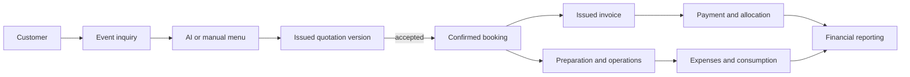

# SSC Synapse Module and API Breakdown

Each module owns its rules, data access, permissions, REST surface, and audit events. The MVP emphasizes the customer-to-payment path; later modules use the same boundaries rather than bypassing them. Routes below are representative versioned resources under `/api/v1`, not a substitute for the generated OpenAPI contract.

## Shared API standards

- JSON request and response bodies use camelCase; dates are ISO 8601 and money includes currency.
- Collection endpoints use cursor pagination where ordering is stable and offset pagination only for small administrative lists.
- Filtering and sorting use allowlisted fields; arbitrary database expressions are rejected.
- Errors follow one envelope with machine code, message, field details, correlation ID, and safe metadata.
- Mutations return the authoritative persisted resource and include a version or ETag where optimistic concurrency applies.
- Financial writes require `Idempotency-Key`; critical edits require `If-Match` or an expected version.
- Authentication, permission, tenant scope, validation, rate limits, audit emission, and OpenAPI descriptions are applied consistently.
- The API exposes `/health/live`, `/health/ready`, and version metadata separately from business routes.

## Module map

| Module                | Responsibility                                                                  | Phase                          |
| --------------------- | ------------------------------------------------------------------------------- | ------------------------------ |
| Auth                  | Login, logout, refresh rotation, recovery, invitations, sessions, login history | 1                              |
| Users and Access      | Memberships, roles, permissions, account state, profiles                        | 1                              |
| Customers             | CRM records, contacts, duplicate warnings, notes, history                       | 1                              |
| Events                | Lifecycle, schedules, venues, conflicts, assignments, history                   | 1 foundation; 2 operations     |
| Catalog               | Dishes, categories, versions, prices, packages, dietary data                    | 1                              |
| Recipes and Costing   | Recipes, ingredient quantities, serving assumptions, deterministic costing      | 1 baseline; 2 full             |
| AI Menu               | Grounded menu generation, validation, usage limits, approval                    | 1                              |
| Quotations            | Drafts, versions, issuance, PDF, delivery, acceptance                           | 1                              |
| Invoices              | Invoice generation, issuance, balance, PDF, receipt and credit documents        | 1                              |
| Payments              | Payment recording, allocation, voids, refunds, reconciliation                   | 1                              |
| Dashboard and Reports | Operational KPIs, charts, drill-downs, exports                                  | 1 baseline; later advanced     |
| Documents             | Upload metadata, signed access, PDF rendering, public shares                    | 1                              |
| Notifications         | In-app events, email delivery, preferences, reminders                           | 1 transactional; 2 operational |
| Expenses and Vendors  | Costs, receipts, vendor balances and payments                                   | 2                              |
| Inventory             | Stock, lots, movements, reservations, consumption and wastage                   | 2                              |
| Staff and Operations  | Availability, assignments, checklists and preparation                           | 2                              |
| Synapse AI            | Permission-aware natural language read tools and confirmed actions              | 3                              |
| Settings              | Business, branding, numbering, tax, AI budget, provider configuration           | 1                              |
| Audit and Platform    | Audit search, outbox, jobs, idempotency and health                              | 1                              |

## Authentication and access

### Backend capabilities

- Authenticate credentials with Argon2id and rate limiting.
- Rotate refresh tokens and detect token-family replay.
- Revoke one session or all user sessions.
- Invite users and activate memberships without exposing temporary passwords.
- Resolve roles into permission keys and enforce financial-visibility restrictions.
- Record login outcome and sensitive administrative changes.

### Representative endpoints

- `POST /auth/login`, `/auth/refresh`, `/auth/logout`, `/auth/logout-all`
- `POST /auth/forgot-password`, `/auth/reset-password`
- `GET /auth/me`, `/auth/sessions`; `DELETE /auth/sessions/:id`
- `GET/POST /users`, `GET/PATCH /users/:id`
- `POST /invitations`, `POST /invitations/:token/accept`
- `GET/POST/PATCH /roles`; `PUT /roles/:id/permissions`

### Frontend screens

Login, recovery, invitation acceptance, profile, active sessions, user list, user editor, role editor, and login history.

## Customers

### Backend capabilities

- Normalize contact details and present duplicate candidates before creation.
- Create, edit, archive, merge, search, and retrieve customer history.
- Aggregate events, quotations, invoices, payments, lifetime value, and balance from source records.
- Preserve communication notes and dietary preferences with proper visibility.

### Representative endpoints

- `GET/POST /customers`
- `GET/PATCH /customers/:id`; `POST /customers/:id/archive`
- `GET /customers/duplicate-candidates`
- `GET/POST /customers/:id/contacts` and `/notes`
- `GET /customers/:id/timeline`, `/financial-summary`
- `POST /customers/:id/merge`

### Frontend screens

Searchable customer table, create/edit drawer or page, customer detail workspace, timeline, financial summary, duplicate-resolution flow, and archive confirmation.

## Events and bookings

### Backend capabilities

- Create and update inquiries with customer, guest, schedule, venue, service, and budget data.
- Validate status transitions and record append-only status history.
- Detect overlapping venue, resource, and staff reservations.
- Duplicate events without copying financial documents or completed operational records.
- Confirm, postpone, reschedule, cancel, and close with reasons and permission checks.
- Expose list, calendar, Kanban, and upcoming-event projections.

### Representative endpoints

- `GET/POST /events`; `GET/PATCH /events/:id`
- `POST /events/:id/transition`, `/duplicate`, `/reschedule`
- `GET /events/calendar`, `/events/kanban`, `/events/:id/history`
- `GET/PUT /events/:id/venue`; `GET /events/conflicts`
- `GET/POST /events/:id/assignments`, `/tasks`, `/resources`

### Frontend screens

Calendar, list, Kanban board, event creation wizard, conflict review, event detail workspace, status controls, notes, files, activity, team, and checklist tabs.

The wizard is resumable and uses the flow Customer, Event Details, Guest Requirements, AI Menu, Quotation, and Booking Confirmation. Each completed step persists a draft rather than depending on browser-only state.

## Menu catalog, recipes, and costing

### Backend capabilities

- Manage categories, stable dish identities, approved dish versions, dietary labels, allergens, and images.
- Create versioned recipes with unit conversion, yield, wastage, and completeness validation.
- Manage effective-dated prices and reusable versioned menu packages.
- Calculate recipe cost, event quantities, per-person price, total price, profit, margin, and budget difference deterministically.
- Preserve snapshots when a menu is approved or enters an issued quotation.

### Representative endpoints

- `GET/POST /dish-categories`, `/dishes`, `/ingredients`, `/menu-packages`
- `GET/PATCH /dishes/:id`; `POST /dishes/:id/versions`
- `GET/PUT /dish-versions/:id/recipe`; `POST /recipes/:id/approve`
- `POST /costing/recipes/:id/calculate`, `/costing/event-menu`
- `GET/POST /events/:id/menus`; `POST /event-menus/:id/approve`

### Frontend screens

Catalog grid and table, dish editor, recipe builder, price history, package builder, event menu editor, costing completeness panel, and kitchen approval view.

## AI Menu Studio

### Backend capabilities

- Validate event type, guests, budget, cuisine, course counts, dietary constraints, preferences, service style, season, and instructions.
- Retrieve a bounded eligible catalog set using relational filters.
- Invoke the configured model with a published prompt and strict structured-output schema.
- Reject unknown IDs, disallowed items, malformed output, and violated hard constraints.
- Run deterministic quantity and financial calculations for Budget, Balanced, and Premium options.
- Store prompt/model provenance, token use, estimated cost, catalog versions, and provisional reasons.
- Regenerate, compare, edit, approve, and convert an option into an event menu.

### Representative endpoints

- `POST /ai/menu-recommendations`
- `GET /ai/menu-recommendations/:id`
- `POST /ai/menu-recommendations/:id/regenerate`
- `POST /ai/menu-recommendations/:id/options/:optionId/adopt`
- `GET /ai/usage`, `/ai/budget`

### Frontend screens

Guided requirement form, streaming or staged generation state, three-option comparison, budget and margin visualization, source-data completeness warnings, editable option detail, regenerate controls, and approval action.

## Quotations

### Backend capabilities

- Create a manual draft or derive it from an approved event menu.
- Recalculate line items, fixed or percentage discounts, taxes, charges, and totals.
- Create sequential immutable versions, compare versions, issue branded PDFs, and supersede older offers.
- Deliver by email, create expiring share links, track status, and accept or reject a precise version.
- Convert acceptance into a confirmed booking through a transaction with status and snapshot checks.

### Representative endpoints

- `GET/POST /quotations`; `GET /quotations/:id`
- `POST /quotations/:id/versions`; `PATCH /quotation-versions/:id`
- `POST /quotation-versions/:id/issue`, `/send`, `/accept`, `/reject`
- `GET /quotations/:id/compare?left=&right=`
- `POST /quotation-versions/:id/convert-to-booking`

### Frontend screens

Quotation list, builder, line editor, totals panel, terms editor, preview, revision compare, delivery/status timeline, and acceptance confirmation.

## Invoices, payments, and refunds

### Backend capabilities

- Generate deposit, progress, final, or manual invoices from confirmed commercial terms.
- Issue immutable invoice lines and branded PDFs.
- Record idempotent payments and allocate them across one or more invoices.
- Derive unpaid, partially paid, paid, overdue, refunded, and partially refunded states.
- Void eligible mistakes through controlled status changes; use credit notes and refunds for issued financial corrections.
- Generate receipts and expose a complete financial timeline.

### Representative endpoints

- `GET/POST /invoices`; `GET/PATCH /invoices/:id`; `POST /invoices/:id/issue`
- `POST /invoices/from-booking`; `POST /invoices/:id/send`
- `GET/POST /payments`; `POST /payments/:id/allocate`; `POST /payments/:id/void`
- `POST /payments/:id/refunds`; `POST /invoices/:id/credit-notes`
- `GET /invoices/:id/ledger`, `/payments/:id/receipt`

### Frontend screens

Invoice list and aging filters, invoice builder and detail, payment-recording dialog, allocation flow, receipt view, refund request and approval, credit-note builder, and customer financial timeline.

## Dashboard and reports

### Backend capabilities

- Calculate revenue, collections, outstanding balances, expenses, estimated profit, upcoming events, pending quotations, bookings, customers, and event counts from real data.
- Distinguish quoted, estimated, invoiced, collected, accrued expense, estimated profit, and realized profit.
- Provide date and event filters, drill-down resource links, CSV exports, and queued PDF exports.
- Generate operational widgets for upcoming events, inquiries, approvals, reminders, low stock, and AI insights as their source modules become available.

### Representative endpoints

- `GET /dashboard/summary`, `/dashboard/revenue-trend`, `/dashboard/upcoming-events`
- `GET /reports/revenue`, `/reports/receivables-aging`, `/reports/event-profitability`
- `POST /reports/exports`; `GET /reports/exports/:id`

### Frontend screens

Responsive KPI dashboard, date filter, trend and distribution charts, drill-down tables, report catalog, filter builder, and export history.

## Expenses, vendors, inventory, and operations

These Phase 2 modules are designed in Phase 1 because their data affects true profitability and kitchen planning.

- **Expenses and vendors:** vendor directory, event and overhead expenses, receipt uploads, approval, vendor payment allocation, planned-versus-actual reporting.
- **Inventory:** ingredients, units, locations, receipts, lots, adjustments, reservations, event issue, returns, wastage, low-stock alerts, and movement history.
- **Staff operations:** staff profiles through memberships, availability, conflict-aware assignments, preparation and delivery checklists, completion reports.

Representative route families are `/vendors`, `/expenses`, `/vendor-payments`, `/inventory/items`, `/inventory/movements`, `/inventory/reservations`, `/staff/availability`, and `/events/:id/tasks`.

## Synapse AI

Phase 3 exposes curated tools rather than arbitrary queries.

| Tool class     | Examples                                                                     | Mutation rule                                                |
| -------------- | ---------------------------------------------------------------------------- | ------------------------------------------------------------ |
| Read           | Upcoming events, outstanding balances, menu margins, ingredient requirements | Permission checked; no confirmation needed                   |
| Analysis       | Compare completed events, reduce menu cost, summarize report                 | Uses bounded datasets and cites internal source records      |
| Draft          | Prepare a menu, quotation, task plan, or customer note                       | Creates a private draft only after clear user intent         |
| Critical write | Confirm booking, issue invoice, record payment, adjust inventory             | Show exact action and require one-time explicit confirmation |

Each tool has a Zod schema, permission key, rate policy, audit policy, and stable application service. The assistant cannot call Prisma or execute SQL.

## Settings, documents, notifications, and audit

- **Settings:** business profile, branding, contact details, currency, timezone, numbering, tax profiles, document terms, serving assumptions, AI model and budgets, provider health.
- **Documents:** upload initiation, completion verification, signed downloads, generated PDFs, expiring public shares, retention and cleanup.
- **Notifications:** in-app feed, preferences, email delivery and retry, event and financial reminder rules.
- **Audit:** filter by actor, action, entity, risk, and date; view safe before/after summaries; export restricted records.

Provider credentials remain environment variables, not editable database values. Settings store only non-secret provider choices and operational policies.

## Permission groups

Permission keys are granular even when default roles bundle them.

- `customers.read`, `customers.manage`, `customers.merge`
- `events.read`, `events.manage`, `events.transition`, `events.assign`
- `catalog.read`, `catalog.manage`, `recipes.approve`, `costing.view`
- `ai.generate_menu`, `ai.view_usage`, `ai.manage_settings`
- `quotations.read`, `quotations.manage`, `quotations.issue`, `quotations.accept`
- `invoices.read`, `invoices.manage`, `invoices.issue`
- `payments.read`, `payments.record`, `payments.refund`, `credit_notes.issue`
- `expenses.read`, `expenses.manage`, `vendors.manage`
- `inventory.read`, `inventory.receive`, `inventory.adjust`, `inventory.issue`
- `staff.read`, `staff.assign`, `tasks.manage`
- `reports.operational`, `reports.financial`, `reports.export`
- `users.manage`, `roles.manage`, `settings.manage`, `audit.read`

Default role mappings are seed configuration and are tested, not scattered as role-name checks in controllers.

## UI navigation and design system

Primary navigation follows the product brief: Dashboard, Customers, Events and Bookings, AI Menu Studio, Menu Catalog, Quotations, Invoices and Payments, Expenses, Inventory, Vendors, Staff and Operations, Reports and Analytics, Synapse AI, and Settings. Items are hidden or disabled based on effective permissions, while the API remains the security boundary.

The visual system uses deep navy and indigo foundations, violet or electric-blue accents, emerald success, amber warning, and red error. Tokens cover light and dark themes, typography, spacing, elevation, radius, motion, chart palettes, and document branding. Reusable patterns include page headers, filter bars, data tables, KPI cards, timelines, money summaries, status badges, activity feeds, steppers, command search, confirmation dialogs, and permission-aware empty states.

## Cross-module workflow ownership

The initiating module coordinates through application interfaces, while the module that owns an aggregate remains responsible for its invariants. For example, quotation acceptance requests an event transition; it does not update the event table directly.
