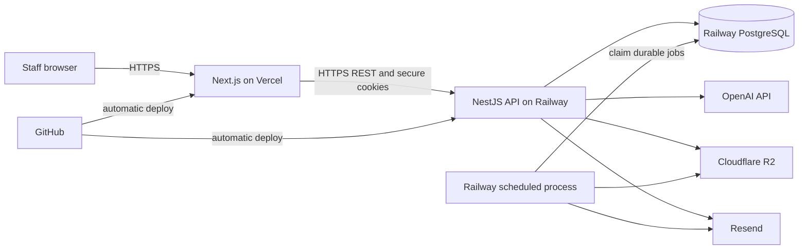
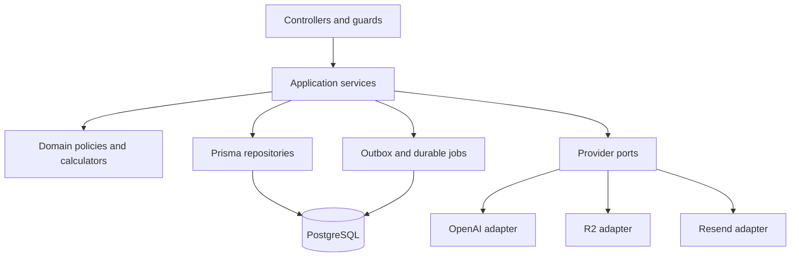
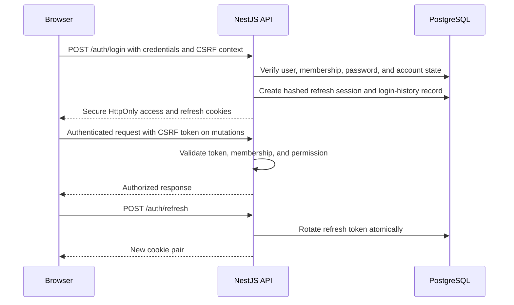
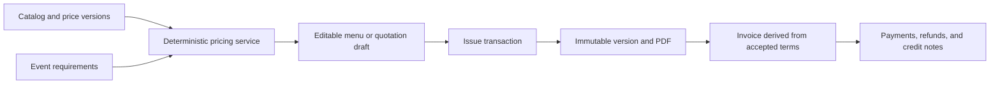
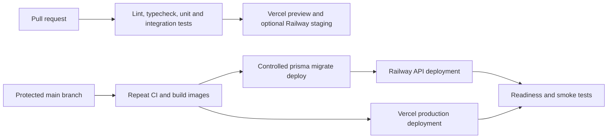

# SSC Synapse System Architecture

SSC Synapse uses a tenant-aware modular monolith: a Next.js web application, a NestJS API, and PostgreSQL as the transactional source of truth. This is the lowest-complexity architecture that still enforces reliable financial boundaries, supports AI safely, and allows later extraction of workers or high-volume services without rewriting the domain.

## Runtime topology



The browser never calls OpenAI, PostgreSQL, R2, or Resend directly with privileged credentials. Uploads may use short-lived signed URLs issued by the API, while the API retains authorization and metadata control.

## Repository shape

The implementation should use a `pnpm` monorepo so frontend, backend, shared contracts, and tooling evolve atomically.

```text
ssc-synapse/
  apps/
    web/                 Next.js App Router frontend
    api/                 NestJS REST API and scheduled-job entrypoint
  packages/
    api-client/          generated typed client from OpenAPI
    config/              shared TypeScript, ESLint, and environment helpers
    contracts/           cross-process primitives only; no domain behavior
    pdf-templates/       quotation, invoice, and receipt templates
    test-utils/          factories, fixtures, and test containers
    ui/                  shared design-system components used by the web app
  prisma/
    schema.prisma
    migrations/
    seed.ts
  docs/
  .github/workflows/
  docker-compose.yml
  pnpm-workspace.yaml
```

Domain entities do not live in a shared frontend package. The API remains authoritative; the frontend consumes generated OpenAPI types and view-specific schemas.

## Backend boundaries



- **Presentation layer:** REST controllers, OpenAPI annotations, DTO parsing, authentication guards, permission guards, pagination, and response mapping.
- **Application layer:** use-case orchestration, transaction boundaries, authorization context, idempotency, audit emission, and provider coordination.
- **Domain layer:** status-transition policies, money calculations, quantity calculations, margin rules, conflict detection, and invariants. It has no NestJS or Prisma dependency.
- **Infrastructure layer:** Prisma repositories and adapters for AI, storage, email, clocks, identifiers, logging, and job execution.

Modules communicate through explicit application interfaces and domain events, not by importing another module's repository or querying its tables from controllers.

## Frontend architecture

Next.js App Router supplies the application shell, route-level authorization hints, public document views, and server-rendered initial data where it improves perceived speed. Protected business data is still authorized by the API on every request.

- Route groups separate authentication, application, and public-share experiences.
- TanStack Query owns remote server state, mutations, cache invalidation, and optimistic UI only where safe.
- React Hook Form and Zod handle interactive forms; the API repeats all validation independently.
- The generated OpenAPI client provides request and response typing.
- Server Components render stable shells and low-volatility views; Client Components handle tables, forms, charts, calendars, and the AI Studio.
- URL search parameters carry shareable filters, pagination, sort, date range, and view mode.
- The UI package centralizes tokens, shadcn/ui-based primitives, access-aware navigation, money/date formatting, and consistent states.

The browser displays estimates and previews but never becomes the authority for invoice totals, booking transitions, permissions, or menu costing.

## Authentication and authorization



Production should use custom sibling domains such as `app.example.com` and `api.example.com`. Cookies are `Secure`, `HttpOnly`, narrowly scoped, and configured with the strictest workable `SameSite` value. If deployment uses cross-site Vercel and Railway hostnames, cookies require `SameSite=None` plus robust CSRF tokens and exact-origin validation.

Authorization combines:

1. Authenticated identity and active session.
2. Active membership in the selected business.
3. Permission grants from system or custom roles.
4. Resource constraints such as assignment-only access.
5. Field-level visibility for sensitive financial data.

The API constructs a request-scoped `ActorContext` with `userId`, `businessId`, permissions, session ID, and correlation ID. Repository calls require this context or an explicit system-job context.

## Transaction and consistency model

PostgreSQL transactions protect aggregate changes. External calls do not occur inside long-running database transactions.

- A mutation writes domain state, audit data, and an outbox message in one transaction.
- A scheduled process leases due outbox jobs with `FOR UPDATE SKIP LOCKED`, performs delivery, and records attempts.
- Idempotency records bind a business, endpoint, actor, and client key to a request hash and stored result.
- Financial operations use serializable or carefully locked transactions when concurrent allocation could overpay or double-refund.
- Editable aggregates carry a version number; updates include the expected version.
- Provider webhooks, when introduced, are verified, deduplicated, stored, and processed asynchronously.

## Financial architecture

All money is represented as a currency plus a fixed-point decimal with explicit rounding. Database values use `Decimal(19,4)` for inputs and calculations; issued document totals are rounded using the currency policy and stored as immutable snapshots.



Documents use explicit line items instead of recalculating history from the current catalog. Payments, refunds, and credits are append-only. An invoice balance is derived from issued total, allocated payments, refunds, and credit notes; a cached balance may be stored only with invariant checks.

## AI menu architecture

```mermaid
sequenceDiagram
    participant U as Authorized user
    participant API as AI application service
    participant DB as Catalog repositories
    participant M as OpenAI
    participant P as Pricing service

    U->>API: Submit menu requirements
    API->>DB: Retrieve eligible dishes, labels, current price and recipe versions
    API->>API: Redact and cap context; enforce AI budget
    API->>M: Versioned prompt plus structured schema
    M-->>API: Dish IDs, rationale, and suggested composition
    API->>API: Validate schema, IDs, permissions, and dietary constraints
    API->>P: Calculate quantities, costs, price, and margin
    P-->>API: Deterministic totals and completeness flags
    API->>DB: Store recommendation, prompt version, usage, and source versions
    API-->>U: Editable provisional options
```

The model selects or ranks catalog identifiers and explains choices; it never supplies authoritative prices. Unknown dish suggestions are isolated as proposals and require catalog approval. Missing recipe or cost data marks calculations as incomplete. Allergy output always includes a kitchen-verification warning.

Conversational Synapse AI reuses the same approach later: a small registry of validated read tools and confirmation-gated write tools. The model receives no raw database connection and cannot submit SQL.

## Document and file architecture

- The API stores file metadata and ownership in PostgreSQL.
- R2 object keys are generated by the server and scoped by environment and business.
- Uploads use content limits, allowlisted media types, randomized keys, and optional malware scanning before becoming available.
- Quotation, invoice, receipt, and credit-note PDFs are created from versioned templates and immutable document snapshots.
- `@react-pdf/renderer` is the initial PDF implementation to avoid a headless-browser runtime; the template package remains replaceable.
- Private downloads use short-lived signed URLs. Public customer shares use revocable, hashed, expiring tokens that resolve through the API.

## Background processing without Redis

The MVP uses two PostgreSQL tables: an outbox for domain-triggered work and a durable job table for scheduled work. Jobs include email delivery, PDF regeneration, reminder evaluation, file cleanup, and reporting exports.

A Railway cron process starts on a schedule, leases a bounded batch, processes it, and exits. Interactive requests may also process short work directly after committing data. Critical work is never stored only in process memory. Redis and BullMQ become appropriate when queue latency, throughput, rate limiting, or worker concurrency outgrow the database approach.

## Observability

- Emit JSON logs with environment, service, module, correlation ID, actor ID where safe, business ID, route, duration, outcome, and error code.
- Redact secrets, tokens, prompts containing unnecessary personal data, and sensitive payment fields.
- Expose `/health/live` without dependencies and `/health/ready` with bounded database and provider configuration checks.
- Track request latency, error rate, database pool use, slow queries, job age, failed deliveries, AI tokens and estimated cost, and financial mutation failures.
- Send exceptions to a configurable error tracker when selected; platform logs remain the baseline.
- Create billing and usage alerts in Vercel, Railway, OpenAI, R2, and Resend before launch.

## Deployment and environments

Use isolated development, preview or staging, and production configuration. Preview deployments must not connect to production data.



Migrations are backward-compatible whenever possible: expand schema, deploy compatible code, backfill, switch reads, then contract in a later release. A failed application deploy rolls back to the previous artifact; a committed production migration is normally forward-fixed rather than destructively reverted.

## Scalability path

Scaling begins with larger Railway instances, additional stateless API replicas, query tuning, and read-model indexes. Likely later extractions are a dedicated job worker, Redis-backed queues, read replicas, and analytics storage. Service extraction is triggered by measured isolation or scaling needs, not by module count.

Multi-business support adds tenant provisioning, stricter tenant isolation tests, per-tenant branding, entitlements, subscriptions, and usage limits. Because tenant keys, provider ports, audit context, and scoped uniqueness exist from the start, those additions do not require rewriting the core entities.

## Architecture decisions to record during implementation

The repository should add short architecture decision records for authentication transport, tenant enforcement, money and rounding, job leasing, document rendering, public-share security, AI model and schema versioning, object-key policy, and migration deployment. Each record should state context, decision, consequences, and replacement triggers.
